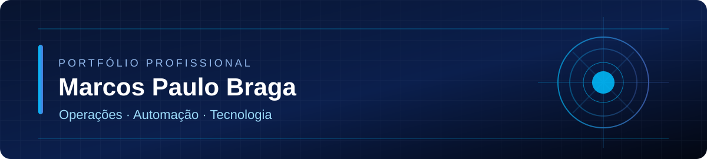

# Olá! Sou Marcos Paulo Braga 👋

**Operações de telecomunicações · Automação · Desenvolvimento de produtos digitais**

Atuo profissionalmente com **monitoramento e operações de telecomunicações**. Também sou fundador da [IMPROVE](https://github.com/JoinImprove), onde participo do planejamento, da definição de requisitos e da evolução de soluções digitais com apoio de IA e desenvolvimento colaborativo.

Gosto de transformar problemas reais em processos claros, ferramentas úteis e sistemas que possam ser testados e melhorados. **Este perfil documenta o que já existe, o que ainda está sendo desenvolvido e o que aprendo no caminho.**

## Projetos em destaque

| Projeto | O que é | O que você pode conferir |
| --- | --- | --- |
| **[Incident SLA Lab](projects/incident-sla-lab/README.md)** | Ferramenta didática em Python que analisa incidentes e indicadores de atendimento. | [Código](projects/incident-sla-lab/incident_sla_lab.py) · [Testes](projects/incident-sla-lab/test_incident_sla_lab.py) · [Dados sintéticos](projects/incident-sla-lab/exemplos/incidentes.csv) |
| **[TITAN Command Center](cases/titan-command-center.md)** | Infraestrutura pessoal para organizar projetos, diagnósticos e agentes de IA com controles de autorização. | Estudo de caso técnico; repositório privado |
| **IMPROVE OS** | Plataforma de operações empresariais em desenvolvimento pela IMPROVE. | Projeto empresarial privado, sem divulgação de código |
| **JAY AI** | Projeto independente de assistente pessoal de IA. | Fase de arquitetura, ainda sem produto demonstrável |

> O **Incident SLA Lab** é uma demonstração pública construída com dados inteiramente fictícios. Não utiliza nem representa informações de clientes, da operadora ou do empregador.

## Ferramentas e tecnologias

- **Desenvolvimento e automação:** Python, Git, GitHub, JavaScript, TypeScript, React e Vite
- **Dados e infraestrutura:** PostgreSQL, Supabase e Cloudflare Pages
- **Métodos:** documentação, testes, revisão, controle de versões, análise de processos e utilização responsável de agentes de IA

*Meu nível de domínio varia entre essas ferramentas. Os projetos combinam desenvolvimento próprio, trabalho colaborativo e assistência de IA; procuro identificar com clareza o que foi realmente implementado e validado.*

## Minha experiência aplicada

- **Operações:** acompanhamento de incidentes, priorização, monitoramento e comunicação de ocorrências.
- **Projetos digitais:** concepção, organização de requisitos, verificação de entregas e evolução de soluções.
- **Automação e IA:** experimentação com ferramentas, agentes e processos sujeitos a permissões e auditoria.
- **Segurança e privacidade:** separação de projetos pessoais e empresariais, proteção de repositórios e cuidado com dados sensíveis.

## Contato e links

[**GitHub**](https://github.com/marcospsbraga) · [**IMPROVE**](https://github.com/JoinImprove)

*Portfólio em evolução — demonstrações publicadas somente quando estão funcionais e podem ser descritas com transparência.*
